# Hàng đặt riêng và Phiếu đi chợ

Đối chiếu cùng dữ liệu kiểm thử cục bộ và cùng trạng thái nghiệp vụ trong Microsoft Edge. Ảnh trước lấy từ commit `21f5e2e5`. Khung nhìn laptop là 1366 × 768, điện thoại là 390 × 844 ở mức thu phóng 100%. Chọn ảnh để xem kích thước gốc.

## Hàng đặt riêng khi đã nhập đủ dữ liệu

Bản nháp gồm 5 kg gạo thơm cho Trường Nguyễn Du. Trước đây Thêm dòng và Xem thay đổi cùng nổi bật. Bản sau dùng nút chính cho Xem thay đổi khi có thể rà soát. Nhân viên vẫn có thể thêm dòng thứ hai. Trên điện thoại, ảnh chụp tại phần thêm dòng; cuộn xuống cuối danh sách để xem nút Xem thay đổi.

| Khung nhìn | Trước                                                                                                   | Sau                                                                                                 |
| ---------- | ------------------------------------------------------------------------------------------------------- | --------------------------------------------------------------------------------------------------- |
| Laptop     | [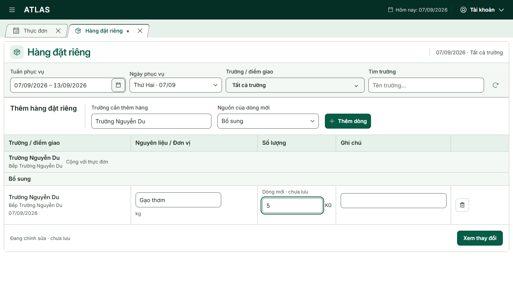](ready-1366-before.png) | [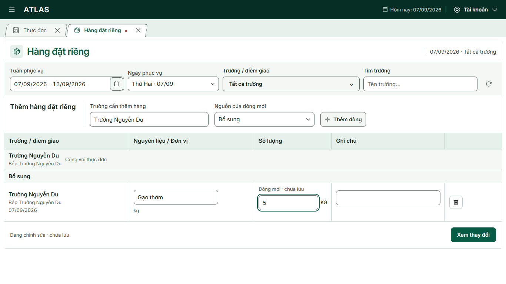](ready-1366-after.png) |
| Điện thoại | [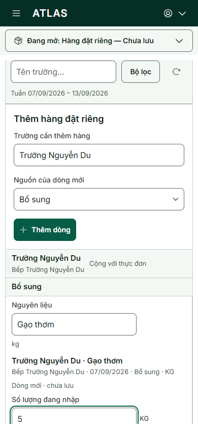](ready-390-before.png)    | [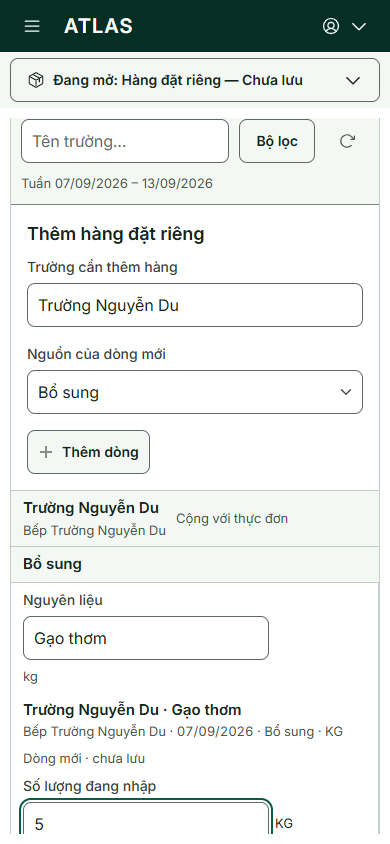](ready-390-after.png)    |

## Quay lại từ khung rà soát

Cả nút ở đầu và cuối khung rà soát đều có nhãn Quay lại chỉnh sửa. Đã kích hoạt từng nút bằng phím Enter ở cả hai kích thước, kiểm tra số lượng 5 kg còn trong bản nháp và tiêu điểm trở về Xem thay đổi. Lưu giữ vai trò chính trong bước rà soát.

| Khung nhìn | Trước                                                                                         | Sau                                                                                       |
| ---------- | --------------------------------------------------------------------------------------------- | ----------------------------------------------------------------------------------------- |
| Laptop     | [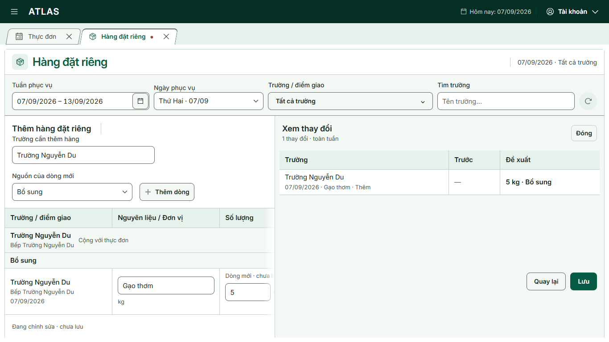](review-1366-before.png) | [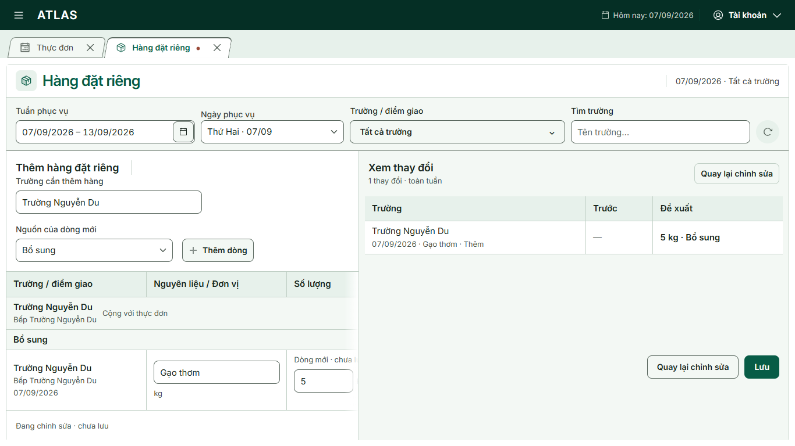](review-1366-after.png) |
| Điện thoại | [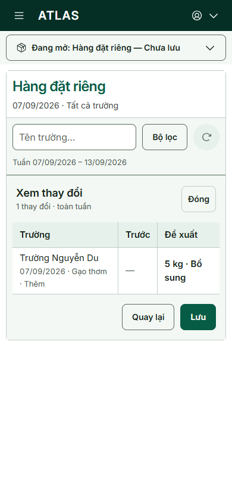](review-390-before.png)    | [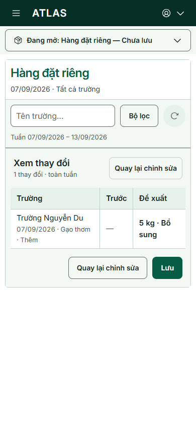](review-390-after.png)    |

## Thông báo trước khi dùng Phiếu đi chợ

Khi còn thay đổi chưa lưu, phần tiện ích giải thích cách giữ hoặc bỏ thay đổi. Đã kiểm tra các lệnh xuất và nhập đều bị khóa trong trạng thái này. Trên điện thoại, mở Tiện ích để xem thông báo.

| Khung nhìn | Trước                                                                                                     | Sau                                                                                                   |
| ---------- | --------------------------------------------------------------------------------------------------------- | ----------------------------------------------------------------------------------------------------- |
| Laptop     | [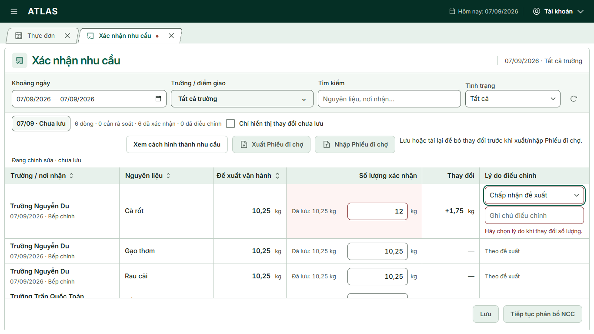](notice-1366-before.png) | [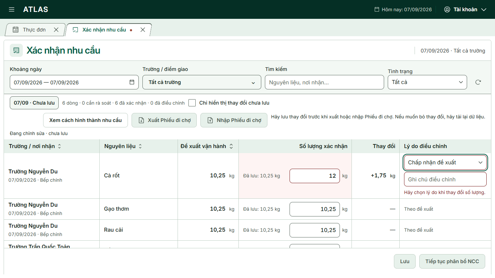](notice-1366-after.png) |
| Điện thoại | [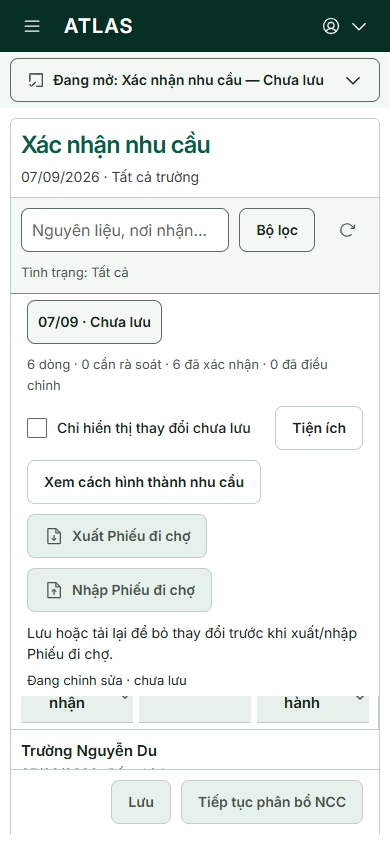](notice-390-before.png)    | [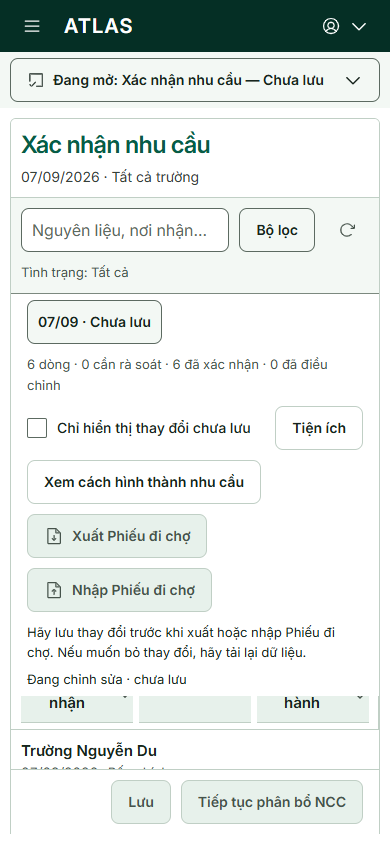](notice-390-after.png)    |
