# Đối chiếu giao diện workbench Atlas

Bản trước lấy từ commit `f4253fb7` trên PR #467. Mỗi cặp ảnh dùng cùng dữ liệu kiểm thử cục bộ, thao tác, kích thước cửa sổ và mức thu phóng 100% trong Microsoft Edge. Chọn ảnh để xem ở kích thước gốc.

## Thực đơn

Bảng với 50 trường hiển thị trọn 6 → 11 dòng trên laptop và 7 → 8 dòng trên điện thoại. Chiều cao vùng cuộn tăng từ 288 lên 434 px và từ 364 lên 422 px, theo thứ tự. Khi mở bộ lọc trên điện thoại, bảng thu lại theo phần diện tích còn lại.

| Kích thước | Trước                                                                     | Sau                                                                   |
| ---------- | ------------------------------------------------------------------------- | --------------------------------------------------------------------- |
| 1366 × 768 | [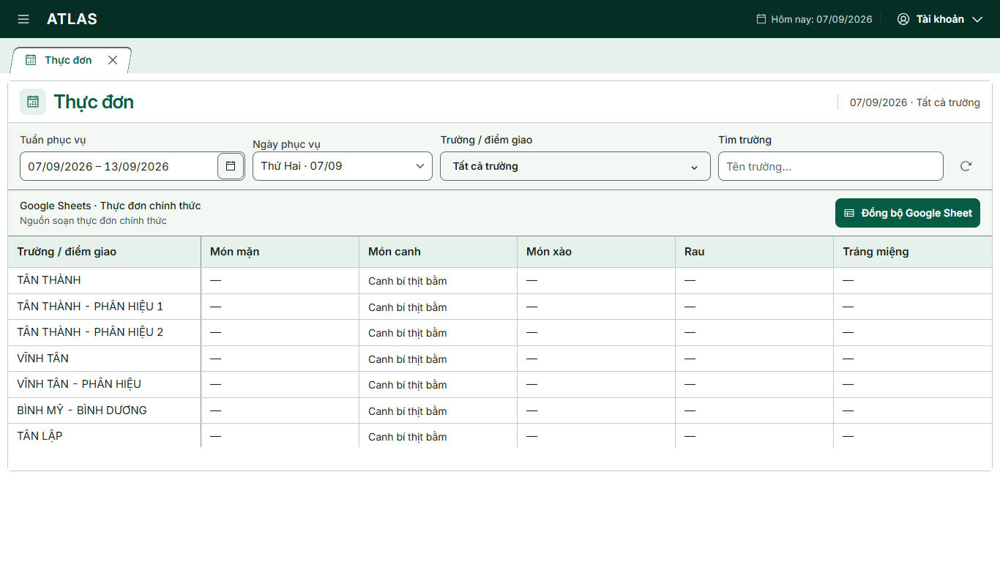](menu-1366-before.png) | [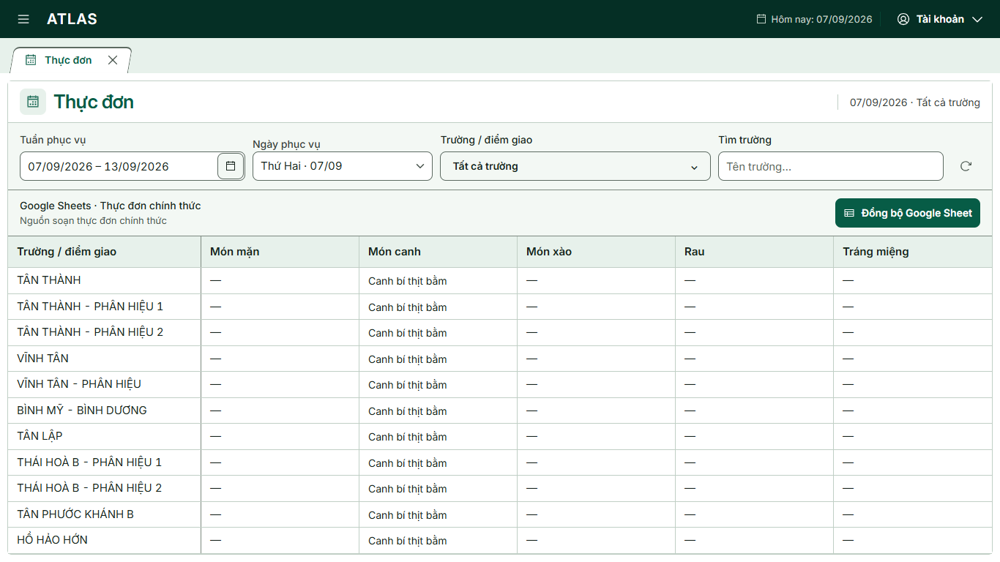](menu-1366-after.png) |
| 390 × 844  | [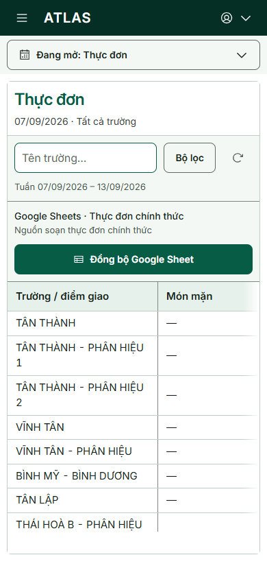](menu-390-before.png)    | [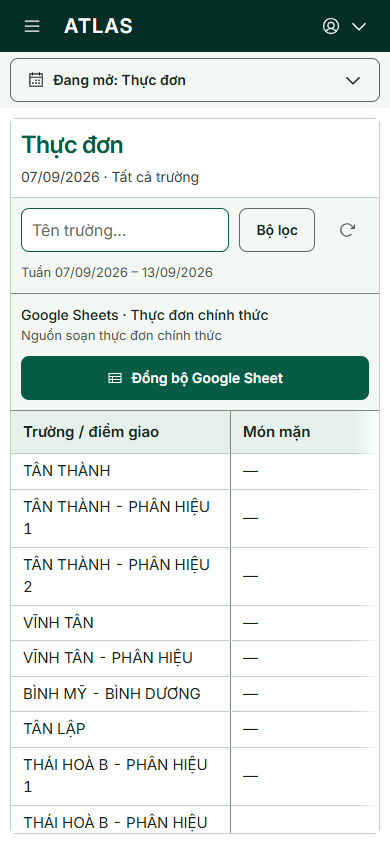](menu-390-after.png)    |

## Hàng đặt riêng

Bản nháp có một dòng 5 kg gạo thơm cho Trường Nguyễn Du. Trên laptop, trước khi chỉnh sửa, Thêm dòng và Lưu đều có nền xanh đậm. Trong bản sau, Thêm dòng dùng kiểu nút phụ khi rà soát và Lưu là nút chính. Trên điện thoại chỉ hiện khung rà soát ở bước này, vì vậy hai ảnh có cùng bố cục.

| Kích thước | Trước                                                                               | Sau                                                                             |
| ---------- | ----------------------------------------------------------------------------------- | ------------------------------------------------------------------------------- |
| 1366 × 768 | [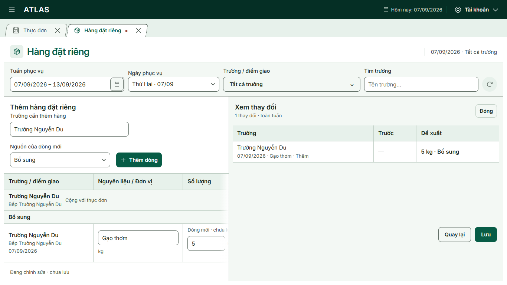](pantry-1366-before.png) | [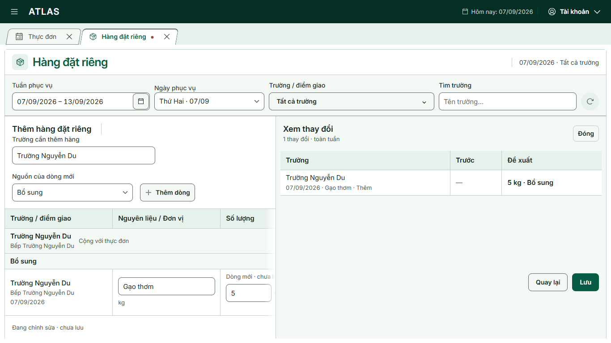](pantry-1366-after.png) |
| 390 × 844  | [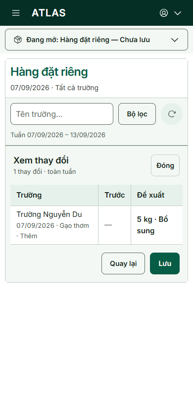](pantry-390-before.png)    |     |

## Trường học

Ô nhập sĩ số mặc định tăng từ 14 lên 15 px trên laptop và từ 14 lên 16 px trên điện thoại. Chiều cao ô vẫn là 36 px và 44 px tương ứng. Hai ảnh đặt con trỏ trong cùng ô Học sinh của trường Tân Thành.

| Kích thước | Trước                                                                           | Sau                                                                         |
| ---------- | ------------------------------------------------------------------------------- | --------------------------------------------------------------------------- |
| 1366 × 768 |  | [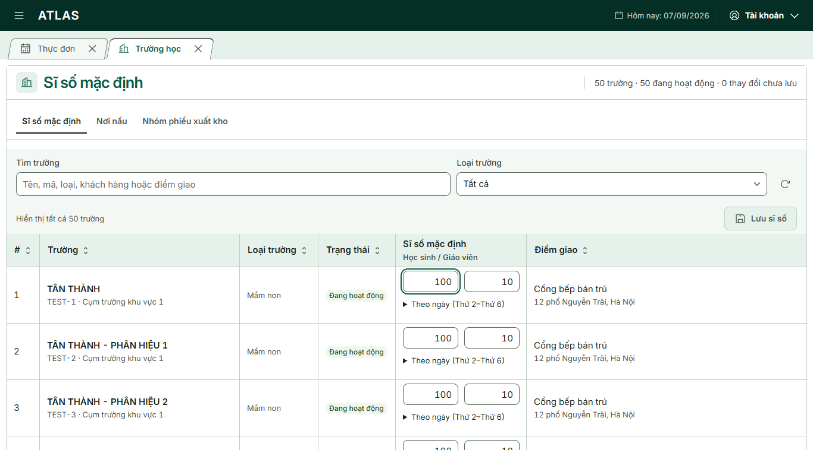](school-1366-after.png) |
| 390 × 844  |     | [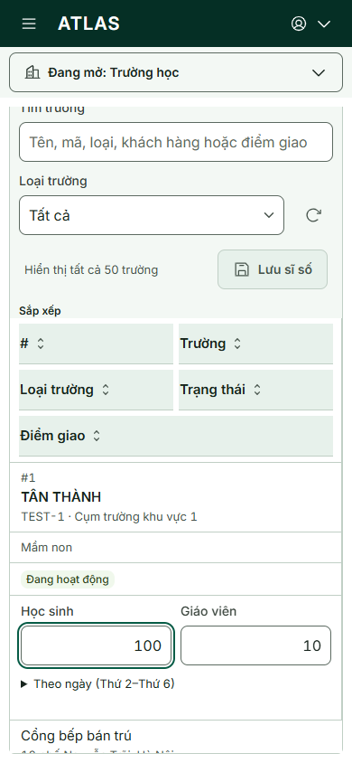](school-390-after.png)    |

## Xác nhận nhu cầu

Tiêu đề Cách hình thành nhu cầu vẫn có cỡ 18 px. Chiều cao dòng chuyển từ 30 px sang 25,2 px theo kiểu tiêu đề phần dùng chung.

| Kích thước | Trước                                                                             | Sau                                                                           |
| ---------- | --------------------------------------------------------------------------------- | ----------------------------------------------------------------------------- |
| 1366 × 768 |  | [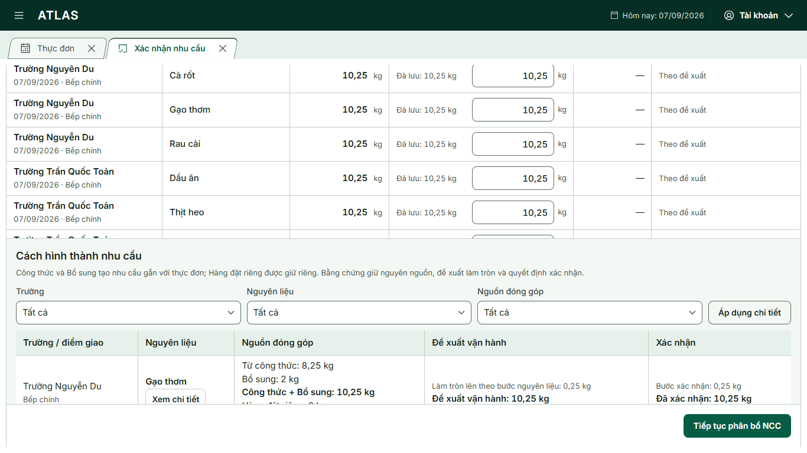](need-1366-after.png) |
| 390 × 844  | [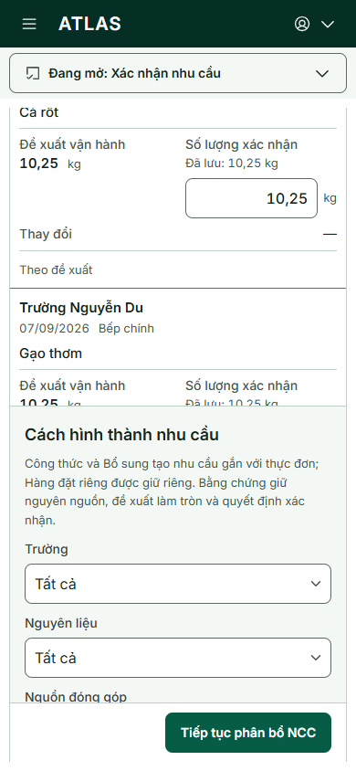](need-390-before.png)    |     |

Đã kiểm tra cuộn bảng bằng bàn phím, mở và đóng bộ lọc trên điện thoại, trả tiêu điểm về Xem thay đổi khi đóng khung rà soát và hiện tiêu đề chi tiết qua Tiện ích trên điện thoại. Các trạng thái đã chụp đều nằm trong chiều rộng của trang. Kích thước điện thoại được mô phỏng trong trình duyệt desktop.
