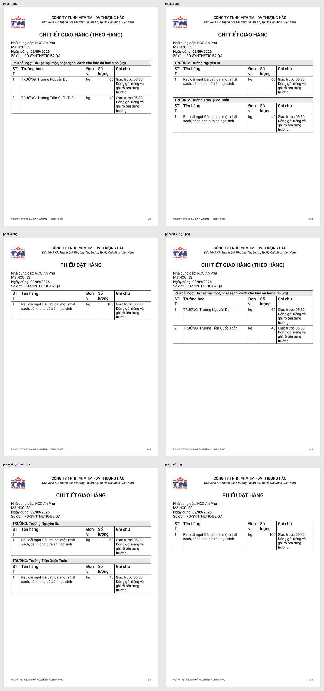
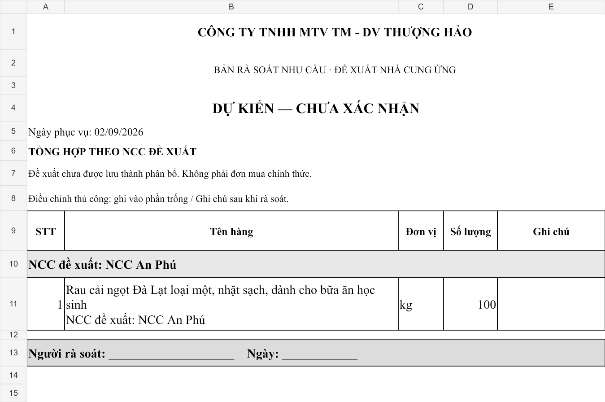
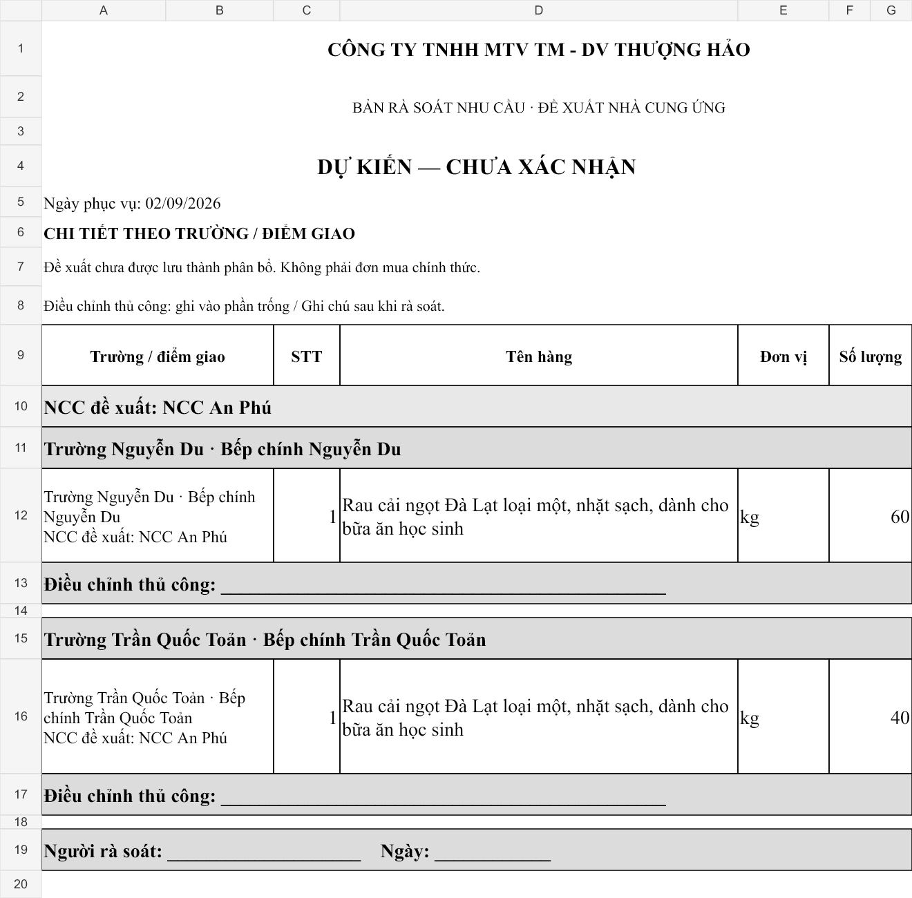

# B2 local verification — optional Ingredient code

Scope and authority: [pre-implementation contract delta](../implementation-tasks/TASK-ATLAS-B2-PO-INGREDIENT-CODE-OPTIONAL-01.md).
Baseline `689398e12f3911182862c76a964434c8776b6bec`; all tests below exercise
the B2 source on the independent task branch. Final exact-head CI URLs and SHA
belong to the Draft PR report; local success is not Product approval.

## Backend evidence

The existing local Supabase database was read only. Atlas schemas/data were copied
to separate disposable database `atlas_b2_20261019`; the three missing baseline
Pantry migrations and B2 were applied only there. No hosted credentials, hosted
migration, real Supplier release, database reset or other checkout was used.
Local privileges were restored exactly by the migration; SQL fixtures roll back.

| Check                                                                                                                             | Result                                     | Evidence                                                                                                                                                                           |
| --------------------------------------------------------------------------------------------------------------------------------- | ------------------------------------------ | ---------------------------------------------------------------------------------------------------------------------------------------------------------------------------------- |
| Unchanged PO baseline                                                                                                             | PASS, 155 assertions                       | Initial disposable-database run                                                                                                                                                    |
| Null-code release/read/replay and complete replacement, plus retained scope/currentness/eligibility/security/atomicity            | PASS, 161 assertions                       | [SQL transcript](artifacts/atlas-b2-po-ingredient-code-optional/sql-green.log)                                                                                                     |
| Native Ingredient creation without manual or caller-supplied technical code; exact replay; existing nullable edit/security checks | PASS, 34 assertions                        | [Master Data transcript](artifacts/atlas-b2-po-ingredient-code-optional/master-data.log)                                                                                           |
| Missing/invalid Supplier code                                                                                                     | PASS, rejected before numbering/commitment | SQL assertions 56–57 and 65; no Supplier guard weakened                                                                                                                            |
| Predecessor number, old nonnull codes/names/Units/notes and snapshots immutable                                                   | PASS                                       | SQL assertions 74–79, 140–149; existing School-history guards retained                                                                                                             |
| New complete replacement with null code and exact School coverage                                                                 | PASS                                       | SQL assertions 137–144 and retained complete-instruction/attribution assertions                                                                                                    |
| Migration first authoring attempt                                                                                                 | FAIL, corrected                            | [Original failure](artifacts/atlas-b2-po-ingredient-code-optional/migration-first-apply.log): boolean formatting emitted `SET t`; the transaction rolled back all function changes |
| Corrected forward apply                                                                                                           | PASS                                       | [Apply transcript](artifacts/atlas-b2-po-ingredient-code-optional/migration-apply.log)                                                                                             |
| Safe reapplication, function definitions/owners/ACL/config, schema privileges and all role memberships unchanged                  | PASS                                       | [Replay transcript](artifacts/atlas-b2-po-ingredient-code-optional/migration-replay.log)                                                                                           |

The expected pre-amendment [red run](artifacts/atlas-b2-po-ingredient-code-optional/sql-red.log)
is preserved. Its downstream historical/replacement failures follow the expected
null-code release rejection; they are not claims about the final source.

## Export and frontend evidence

Five affected files pass 58 tests: official exports, preliminary review, historical
reproduction, retained V1 presentation and the synthetic review journey. Matrix:
`all`, `details_ing`, `details_school`, `sum`, each as XLSX, actual PDF, XLSX ZIP
and PDF ZIP. Tests load every workbook/ZIP, check visible text, A4 geometry,
frozen Supplier code, exact quantity/source identities and no UUID fallback.
[Focused green transcript](artifacts/atlas-b2-po-ingredient-code-optional/frontend-focused-green.log).

The [historical SHA-256 fixtures](artifacts/atlas-b2-po-ingredient-code-optional/historical-baseline.json)
were captured before exporter edits from the exact starting source, using a fixed
release timestamp. The regression compares complete loaded workbook models and
PDF definitions for all four modes. All match. It deliberately does not claim
byte-identical ZIP timestamps or randomized PDF file identifiers.

TypeScript passes after the test ZIP reader was corrected to supply an ArrayBuffer
to ExcelJS. The [initial type error](artifacts/atlas-b2-po-ingredient-code-optional/typecheck.log)
and [initial summary metadata assertion failure](artifacts/atlas-b2-po-ingredient-code-optional/frontend-focused.log)
remain preserved. Summary Ingredient identity is retained in its hidden row
columns; `ROW_SOURCE` retains the exact line-revision reference. No historical
metadata was altered to satisfy that assertion.

Synthetic QA files were produced by the real exporters (5 additional passing
fixture cases), not by a substitute document builder. The
[binary manifest](artifacts/atlas-b2-po-ingredient-code-optional/binary-manifest.json)
identifies 17 generated files. Their names/number explicitly identify QA and
they represent no real supplier commitment. PDF parsing verifies all six pages
are A4, retain `Mã NCC: 53` and contain no visible item-code label/UUID:
[page/text checks](artifacts/atlas-b2-po-ingredient-code-optional/pdf-validation.json).

All six PDF pages were rendered with Poppler and visually inspected for long
Vietnamese names, notes, School ordering, wrapping and page numbers. Both
preliminary worksheets were imported read only and rendered for inspection.
The wider name field and five-column summary remain legible; detail retains its
School/location breakdown and exact 60/40 quantities. Native Excel printing was
not exercised; automated worksheet geometry and rendered PDF evidence do not
claim an Excel application print test.

## Certification and remaining gates

Required final-source jobs are Frontend CI / Format, typecheck, test, build;
Supabase Smoke; and actually executed Supabase Full Integration. Draft stacking
does not trigger main-only PR workflows, so explicitly dispatch the existing
workflows on the B2 branch. Report their final exact SHA, URLs and actual job
conclusions in the Draft PR. No skipped integration job counts as success.

Independent read-only source review found no actionable Critical, Important or
Minor issues. It inspected nullable/corrupt-code guards, Supplier checks, release
ordering, historical metadata, preliminary indices and transactional security
leases. It did not rerun completed suites or inspect the rendered images. The
historical golden covers one synthetic order in four modes; SQL corrupt internal
code read branches were inspected rather than independently isolated in tests.
Final CI and Owner Product review remain separate gates.

No new business/design choice was required: the existing hidden official
column permits historical reproduction without a document-version authority.
Retain nullable issued-document read/export compatibility during any rollback;
never restore the old code requirement across already accepted null-code POs.
