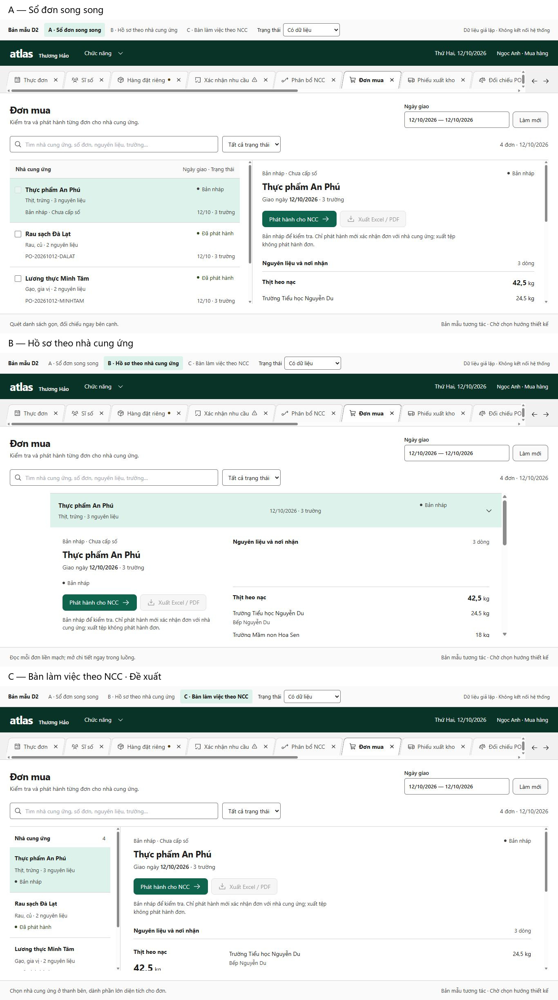

# Atlas art direction — D1 / D2

Design alternatives only, 16 October 2026. Issue [#389](https://github.com/longpsu-bot/thuonghao-ops-erp/issues/389) and the [approved brief](../implementation-tasks/TASK-ATLAS-UX-ART-DIRECTION-02.md) authorize these two checkpoints. Starting main: `3667966a3f6703a6585f07ba619969ec851ca7b8`. Production direction awaits Owner selection. Drafts #385–#388 are preserved, independent and unmerged.

## D1 — guidance actually used

| Guidance                         | Provenance / availability                                                                                                                                                                                                                                                                                | Contribution here                                                                                                                                                                                                     |
| -------------------------------- | -------------------------------------------------------------------------------------------------------------------------------------------------------------------------------------------------------------------------------------------------------------------------------------------------------- | --------------------------------------------------------------------------------------------------------------------------------------------------------------------------------------------------------------------- |
| Frontend Design                  | Installed local skill, Apache-2.0; skill SHA `b8009ae690dfa69edc7f08bb8715f32db8817112cfa4388741dbaf876c237df8`. Reviewed official [Anthropic source](https://github.com/anthropics/skills/tree/dbd4588f9e1033efb41dad4bef2f7947c8993d44/skills/frontend-design). Local hash is not an installed commit. | Three distinct information architectures, deliberate working-plane geometry, restrained typography.                                                                                                                   |
| Impeccable                       | Installed 4.5.0 skill SHA `37680abf9a8e446619fcd33862718f483d197bf2652f966adca8dc54d2909b9d`; existing engine 0.1.11. Upstream reviewed 4.6.0 at `5bf0a069dc857e1b5f4b090e004d9d5b231416ca`; not installed.                                                                                              | New-work, Operate and craft-floor written guidance: earned familiarity, legible density, state coverage, no decorative card grid. Existing `context` command ran once; no download/update or detector infrastructure. |
| Emil Design Engineering          | MIT written reference, reviewed source `2d228630ba1446365f614a108cb8252f1feda202`; not installed.                                                                                                                                                                                                        | Interaction restraint: explicit selection, immediate feedback, focus restoration and no ornamental motion.                                                                                                            |
| Vercel Web Design Guidelines     | MIT written reference, skill 1.0.0 at `063bee94c3f4df8453406c830b0a7df0f2860278`, rules `434b7f91364665f2f733b310ec54809bf8f37937`; not installed.                                                                                                                                                       | Independent checks for keyboard controls, labels, overflow and reduced motion.                                                                                                                                        |
| Official Chakra builder/refactor | Existing vendored MIT skill pin `961161428b8c59157ad921dd23303b73c294d73f`; app Chakra 3.37.0 / React 19.2.7.                                                                                                                                                                                            | Existing Atlas provider, semantic tokens and button recipes; no provider replacement or dependency changes.                                                                                                           |
| Vietnamese technical writing     | Existing local skill and Vietnamese-document workflow.                                                                                                                                                                                                                                                   | Concise operational Vietnamese, decimal comma, dates, quantities paired with Units, controlled absence messages.                                                                                                      |

Terra independently checked provenance/source; Sol read and applied the local design, Impeccable and Chakra guidance. Pinned written references: [Emil](https://github.com/emilkowalski/skills/blob/2d228630ba1446365f614a108cb8252f1feda202/skills/emil-design-eng/SKILL.md), [Vercel skill](https://github.com/vercel-labs/agent-skills/blob/063bee94c3f4df8453406c830b0a7df0f2860278/skills/web-design-guidelines/SKILL.md), [Vercel rules](https://github.com/vercel-labs/web-interface-guidelines/blob/434b7f91364665f2f733b310ec54809bf8f37937/command.md). Claude-only Anthropic Design Plugin and Superdesign cloud workflows are not selected. No installers, accounts, paid credits, hooks, fonts or dependencies were added. The three existing UI-agent instruction files now reference v3 and this D1/D2 boundary instead of v1 / Soft Mineral / clay. They were not launched.

## D1 — actual current application

Root inspected the populated opt-in fixture route `atlas-vnext-review.html?scenario=ready`, opened all thirteen real registry owners and selected a PO. Evidence: [laptop](evidence/atlas-ux-art-direction-02/baseline-1366x768.jpg), [large desktop](evidence/atlas-ux-art-direction-02/baseline-1920x1080.jpg), [DOM measurements](evidence/atlas-ux-art-direction-02/baseline-metrics.json). These are sharp full-page captures at the named viewport sizes; page height can exceed viewport height. Browser console: no errors observed.

The ready fixture has September 7 application scope and September 10 Procurement data. That mismatch is a review-fixture limitation, not live operational evidence. `oct12_recommendations` exists in Procurement stories/fixtures, but is not dispatched by this application review route. The capacity story has twelve placeholder tabs and is not evidence for thirteen populated owners.

| Actual finding                            | Evidence and consequence                                                                                                                                                                                                                | D2 response                                                                                                                                                                     |
| ----------------------------------------- | --------------------------------------------------------------------------------------------------------------------------------------------------------------------------------------------------------------------------------------- | ------------------------------------------------------------------------------------------------------------------------------------------------------------------------------- |
| Separate rounded tab boxes                | `AtlasVNextShell.tsx:475` onwards; detached shapes compete with the working plane.                                                                                                                                                      | Joined white active plane; subtle sloped neutral tabs, separate explicit close controls and retained markers.                                                                   |
| Wide rigid PO list inside split           | `ProcurementOrdersStage.tsx:225` onwards; table 1040px inside 833.27px at 1366px. Reaching the last action needs about 207px local horizontal scroll. No document-wide overflow. At 1920px the list becomes 45% wide and still scrolls. | Supplier-first summaries without seven fixed columns; selected detail is visible from the start.                                                                                |
| Controls precede working content          | Table top 407.69px; first row roughly 450px, over half the 768px viewport. Multiple heading/filter/export rows dilute the main task.                                                                                                    | Compact scope and filter bands, utilities beside the selected document, no large empty hero.                                                                                    |
| Recipient summary is not School evidence  | `locations()` at 108–113 concatenates unique delivery-location names; search at 95–106 does not search School names.                                                                                                                    | Synthetic prototypes separate School, location and exact quantity. One draft explicitly lacks School evidence and cannot issue. This does not claim main has Draft #386 fields. |
| Detail changes composition at large width | `ProcurementOrdersStage.tsx:431` onwards switches cards/table while sparse list/footer remains.                                                                                                                                         | Compare split ledger, inline document journal and focused supplier rail, using identical facts.                                                                                 |
| Bulk utility needs clear meaning          | Existing release is per document; export is a read utility.                                                                                                                                                                             | A shows released-document export selection; no bulk issue. Draft issue confirmation is preview-only and never changes fixture status or number.                                 |

Current business facts, command guards, persistent owners and released snapshots are authoritative. Retool / OPS v1 informs workflow vocabulary only; no Retool or database access occurred for this local design task. Human Units and complete draft-School API evidence in parked #386 are not claimed deployed.

## D2 — working alternatives

Run the existing Vite dev server, then open `/atlas-ux-art-direction-review.html`:

| Alternative                     | Query           | Decision / trade-off                                                                                                                                                                                                           |
| ------------------------------- | --------------- | ------------------------------------------------------------------------------------------------------------------------------------------------------------------------------------------------------------------------------ |
| **A — Sổ đơn song song**        | `?view=ledger`  | Compact supplier ledger plus persistent selected detail. Strong for comparison; less space for very long supplier names.                                                                                                       |
| **B — Hồ sơ theo nhà cung ứng** | `?view=journal` | Orders form a vertical document journal with inline expanded ingredient/School breakdown. Most continuous reading, but moving to later suppliers requires more vertical travel.                                                |
| **C — Bàn làm việc theo NCC**   | `?view=rail`    | **Recommended starting direction** for daily supplier processing. Narrow supplier index plus broad document workplane; quantity and School rows align as an ingredient matrix. Less useful for comparing many document states. |

The entry is `atlas-ux-art-direction-review.html`; its isolated implementation/tests live under `src/vnext/prototypes/atlas-ux-art-direction-02/`. Start with `pnpm exec vite --host 127.0.0.1 --port 5177 --strictPort`. Do not use the connected normal application entry for these mockups.

All use the existing Inter / Segoe UI / Arial stack, Atlas provider, semantic colors, icon set and Chakra recipes. Same synthetic October 12 rows and statuses in every alternative. The separate review controls select populated, busy, empty and blocked states; `&state=busy`, `empty` or `blocked` also work on initial load. Search, status filtering, supplier selection, explicit document confirmation preview, tab close/dirty Cancel/Discard, keyboard tab navigation and released-only export selection are local interactions. Other workbench panels intentionally explain their prototype limit and return to Đơn mua. This does not replace thirteen production reducers or implement business commands.

Release confirmation and export show explicit preview feedback, never fake issuance, server success, downloaded output or new numbers. No API client is imported. Missing draft School evidence is a warning, never inferred from locations. Empty filtered results differ from no documents; neither implies zero Need.

### Review / verification

Target matrix: **1366×768 first**, 1440×900, 1920×1080, 768 and 390. Root performed the batched browser inspection; Terra performed one independent rendered comparison. One correction batch addressed C's narrow Refresh/search geometry. No repeated independent critique, detector infrastructure or production certification followed.

Final direct-URL captures: [A laptop](evidence/atlas-ux-art-direction-02/final/a-1366x768.jpg), [B laptop](evidence/atlas-ux-art-direction-02/final/b-1366x768.jpg), [C laptop](evidence/atlas-ux-art-direction-02/final/c-1366x768.jpg); [A 1440](evidence/atlas-ux-art-direction-02/final/a-1440x900.jpg), [B 1440](evidence/atlas-ux-art-direction-02/final/b-1440x900.jpg), [C 1440](evidence/atlas-ux-art-direction-02/final/c-1440x900.jpg); [C narrow](evidence/atlas-ux-art-direction-02/final/c-390x844.jpg) and [genuine empty state](evidence/atlas-ux-art-direction-02/final/empty-1366x768.jpg). Contact sheet uses the three unscaled final laptop screenshots with labels outside the captures.

The [viewport DOM report](evidence/atlas-ux-art-direction-02/viewport-matrix.json) covers all three alternatives at all five requested sizes: thirteen labels, no horizontal document overflow, bounded desktop workplanes and vertical narrow scrolling. Retained [initial comparison frames](evidence/atlas-ux-art-direction-02/initial-comparison/) supplement the final captures at 1920 / tablet / mobile; they predate the final literal label and C narrow correction. Filenames name requested CSS viewport sizes, not guaranteed bitmap dimensions. Initial stale B-laptop, defective A-tablet and stale state screenshots are excluded. Their underlying DOM observations are not relabeled as final screenshot proof.

[Browser interaction observations](evidence/atlas-ux-art-direction-02/interaction-checks.json) cover empty/filtered-empty, blocked/busy, unavailable School, dirty Cancel, static release-preview status and manual keyboard tab focus/activation with PO selection retained. Unknown/error/recovery backend protocols are not implemented or certified by these throwaway prototypes; production owners remain unchanged. Date scope is deliberately fixed to the synthetic day.

Local checks: **8/8 focused prototype tests PASS**, TypeScript PASS, Atlas UI boundary PASS, Prettier PASS, Vietnamese-copy validator 3 files / 0 findings, three existing agent TOMLs parsed, whitespace clean. Initial Chakra token-prefix hookup and source-folder boundary mistakes were corrected; one empty/filter action defect was caught by the focused test and fixed. No full frontend suite, database, load, hosted or production certification was run. No production UI, backend, SQL, dependency, hosted data or workflow modifications are authorized by this package.

The independent rendered pass recommends C for daily processing, A for comparative scanning and B for uninterrupted single-document review. Remaining selection trade-offs: A places mobile detail below its list; B hides later suppliers below the open dossier; C omits document numbers in its narrow supplier index and has broad quantity spacing at 1920px. Shared chrome can be further condensed after selection. These are comparison trade-offs, not claims of production accessibility or workflow certification.

**Owner selection pending.** Choose A, B or C (or a specific combination) before any production presentation implementation. D1/D2 does not authorize merging parked backend Drafts or changing lifecycle, calculations, scope or permissions.
